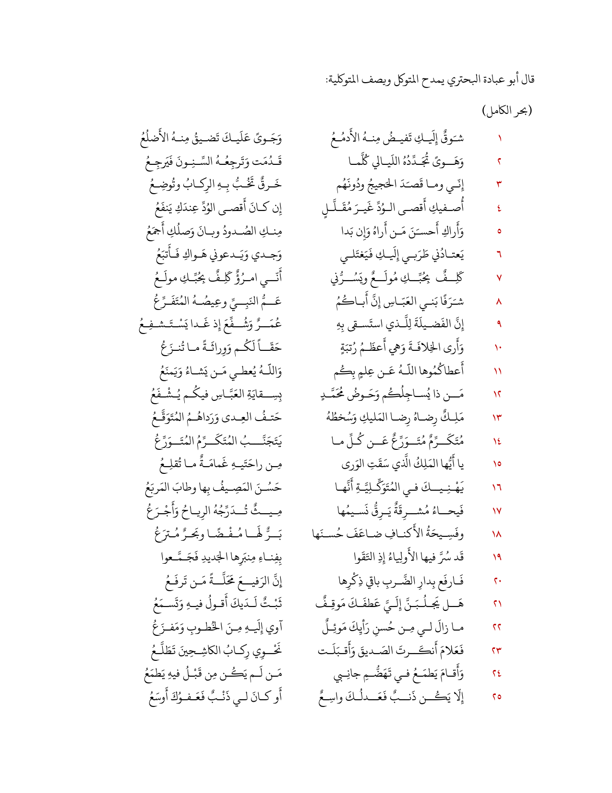
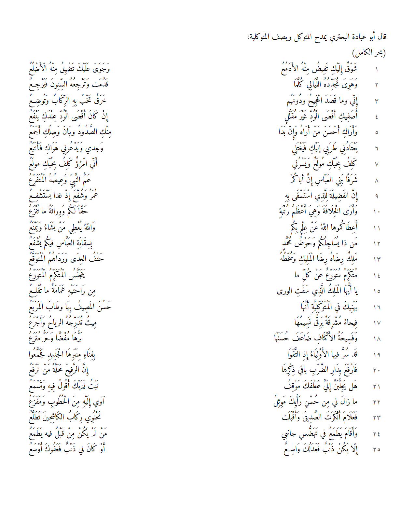
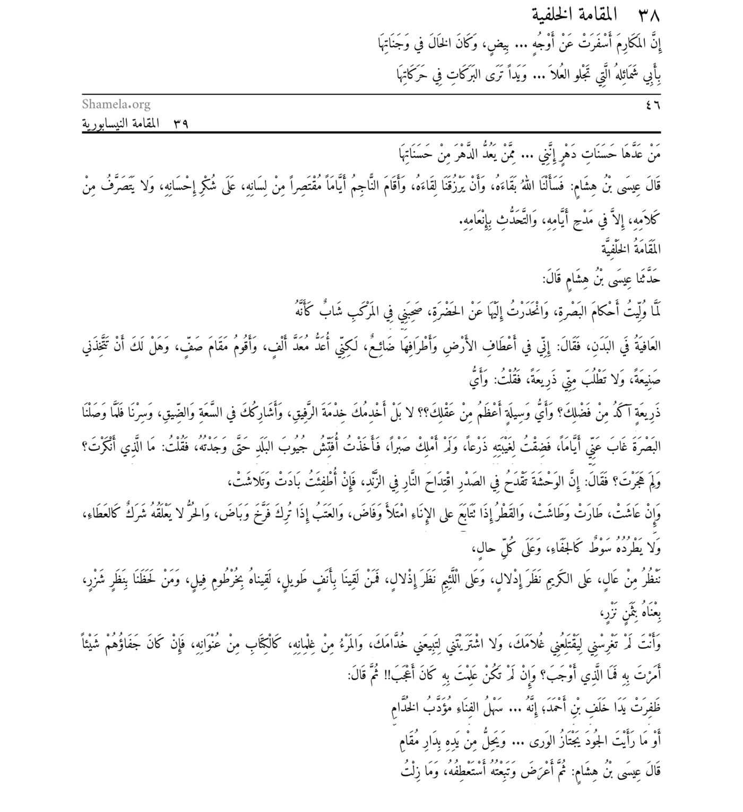
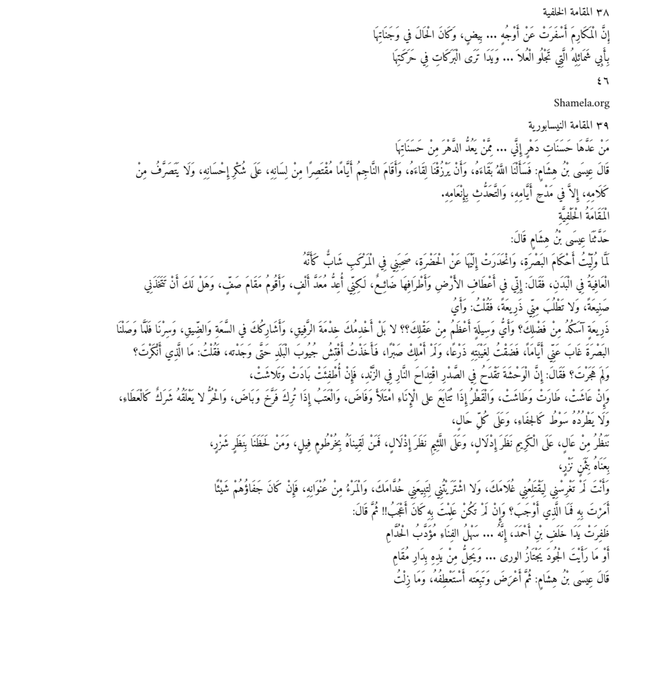

# Arabic OCR

**Reads exactly what is written on scanned pages: every letter and every tashkeel (تشكيل) mark as written on the page.**

> This repository is a project showcase. The model and its source code are private.

## What makes it different

Most Arabic OCR tools drop the tashkeel and return bare letters, which makes them useless for poetry, religious texts, and learning material, where every mark matters. This model reads the page **exactly as it is written**:

- Where the page **has** tashkeel, the model reads every mark.
- Where the page **has none**, the model adds none. It never invents marks that aren't printed.

**Example:** the poem page below opens with a plain line written without tashkeel («قال أبو عبادة البحتري يمدح المتوكل ويصف المتوكلية»), followed by fully vowelled verses. The model reads each one as printed.

## Accuracy

| | |
|:---:|:---:|
| **99.4%** | **97.6%** |
| Letter accuracy | Letter & tashkeel accuracy |

*Accuracy is affected by the font type used on the page.*

## Examples

### Example 1: a full poem

A full page of classical poetry: al-Buhturi's «شوقٌ إليكِ تفيضُ منه الأدمعُ», 25 verses in two columns, with tashkeel. On the left is the test page; on the right is the model's output, rendered back as a page.

| Test page | Model output |
|:---:|:---:|
|  |  |

### Example 2: «المقامة الخلفية»

A page of classical prose with tashkeel: «المقامة الخلفية» from Badi' al-Zaman al-Hamadhani's *Maqamat* (pages 46–47): running headers, a page break, prose, and verse on the same scan. On the left is the test page; on the right is the model's output, rendered back as a page.

| | |
|:---:|:---:|
| **95.8%** | **92.1%** |
| Letter accuracy | Letter & tashkeel accuracy |

| Test page | Model output |
|:---:|:---:|
|  |  |

Test page: from a public PDF on [Shamela.org](https://shamela.org/); rights in the edition belong to its publisher.

## Features

- Exact reading: letters and تشكيل as written on the page
- Poetry layout (verse halves) and prose paragraphs
- Works on scanned book pages

---

### بالعربية

نموذج للتعرّف الضوئي على النص العربي يقرأ النص كما هو مكتوب في الصفحة تمامًا، حرفًا وتشكيلًا.

- **دقة الحروف: ٩٩٫٤٪**
- **دقة الحروف والتشكيل: ٩٧٫٦٪**

تتأثر الدقة بنوع الخط المستخدم في الصفحة.

أمثلة كاملة أعلاه: قصيدة للبحتري، وصفحة من «المقامة الخلفية» لبديع الزمان الهمذاني.

---

Built by [Eng. Nawaf Aljohani](https://github.com/Nawaf-K-Aljohani) · [LinkedIn](https://www.linkedin.com/in/nawaf-aljohani-862a2025b/)
